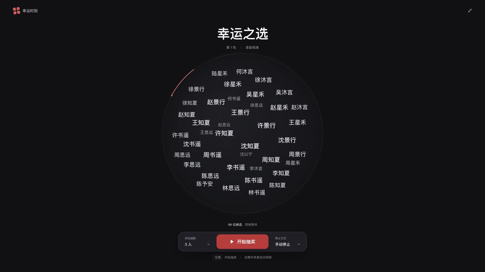

# 幸运时刻

黑红配色、参考 iOS 材质与控件层次的离线桌面抽奖应用。支持 Windows 与 macOS，名单及中奖记录保存在本机。



## 下载

在 [Releases](https://github.com/txcisgood/lucky-moment/releases) 下载 1.2.0：

- [macOS Apple 芯片版](https://github.com/txcisgood/lucky-moment/releases/download/v1.2.0/LuckyMoment-1.2.0-mac-arm64.dmg)
- [macOS Intel 版](https://github.com/txcisgood/lucky-moment/releases/download/v1.2.0/LuckyMoment-1.2.0-mac-x64.dmg)
- [Windows x64 便携版](https://github.com/txcisgood/lucky-moment/releases/download/v1.2.0/LuckyMoment-1.2.0-Windows-x64.exe)

macOS 要求 13 或更新系统，DMG 打开后拖入“应用程序”；Windows 双击 EXE，启动时会自动解压运行时，无需安装 Node.js。当前安装包未进行正式开发者签名／公证，Windows 尚未完成真机验证。Release 同时提供 SHA-256 校验文件。

## 功能

姓名组成居中的空间球体，所有显示的姓名都位于同一个圆形候选区域内，底部为悬浮操作条。点击右上角“抽奖设置”可切换“抽奖规则”和“动效与揭晓”。未导入名单时显示明确标记的示例效果，导入后改为真实候选名单；没有剩余候选时不会显示示例姓名。

动画速度支持 0.5–2 倍（步长 0.25），仅影响视觉运动。中奖名单默认全部揭晓，也可选择逐个揭晓（每隔 0.7 秒一位）；逐个展示时可点击“显示全部中奖者”跳过等待。完整中奖结果在任何姓名揭晓前保存，重启直接显示完整已保存结果。旧活动自动补全新设置，保留名单和中奖记录。

## 使用

1. 导入 Excel（`.xlsx`）、TXT，或直接粘贴名单。
2. Excel 读取第一张工作表的第一列，支持可选的“姓名”表头。TXT／粘贴名单使用中文逗号 `，` 或英文逗号 `,` 分隔，可混用。
3. 设置本轮名称、中奖人数，选择手动停止或定时停止（1–3600 秒）。
4. 开始抽奖后点击停止，或等待倒计时结束。空格键也可开始／停止。
5. 查看中奖记录、导出 Excel，或继续下一轮。

“允许重复中奖”默认关闭，排除所有历史中奖者；开启后往期中奖者可以继续参与。同一轮内同一参与者不会重复中奖。同名记录在导入时可合并或作为独立参与者保留。

全屏按钮进入投屏舞台，Esc 返回。重新开始活动会清空中奖记录并保留名单和设置；导入新名单会在确认后清空原活动记录。最多支持 10,000 人、20 MB 名单文件。旧版 `.xls` 与 CSV 不支持。

[Excel 名单模板](抽奖名单模板.xlsx) · [手工验收用例](手工验收测试用例.xlsx) · [1.2 版验收说明](1.2版验收说明.txt)。`测试数据/` 中均为示例数据；包含故意损坏的文件、不支持格式和 21 MiB 大文件，用于测试错误处理。

## 运行与构建

需要 Node.js 22.12+ 或 24+。应用的最终用户不需要安装 Node.js。

```sh
npm ci
npm run dev
npm run check
```

```sh
# macOS 上生成 Apple Silicon 与 Intel 两套 DMG/ZIP
npm run pack:mac

# 生成 Windows x64 便携版 EXE
npm run pack:win
```

成品输出到 `release/`。Windows 便携版双击运行，启动时会短暂解压运行时；macOS 版本要求 macOS 13 或更新系统，将应用拖入“应用程序”后打开。

当前是本地测试版本：macOS 使用临时签名（ad hoc），尚未进行 Apple Developer 签名与公证；Windows 尚未进行代码签名。公开分发时可配置相应证书。macOS 包应在 macOS 构建；Windows 可在 Windows 本机或通过跨平台打包构建，实际系统兼容性以真机验证为准。

`.github/workflows/ci.yml` 在推送 `main` 和提交 PR 时运行核心测试、生产构建及浏览器端到端测试。`.github/workflows/build.yml` 可手动触发或推送 `v*` 标签，在 macOS 和 Windows 各自构建并保存成品附件。

## 验证

```sh
npm test
npx playwright install chromium
npm run test:e2e
```

核心测试覆盖导入、随机抽取边界、跨轮去重、重复中奖切换、万人名单、Excel 读写与磁盘恢复；端到端测试验证完整抽奖流程、倒计时、名单管理、导出和刷新恢复。

## 数据与实现

- Electron、React、TypeScript、Vite；ExcelJS 按需加载处理 Excel。
- 使用系统提供的 `crypto.getRandomValues`、拒绝采样与部分 Fisher–Yates 算法，避免取模偏差与同轮重复。
- 结果在本地保存成功后才显示。磁盘保存通过临时文件与重命名替换，并保留上一份备份。
- 桌面数据位于 Electron 的用户数据目录中的 `activity/`；应用目录名由运行时的应用名称决定。主文件为 `activity.json`，上一次备份为 `activity.backup.json`。
- 开发时浏览器预览使用浏览器本地存储，与桌面应用的数据分开。
- 应用不请求远程资源、不上传姓名、不接入统计服务。渲染进程启用沙箱、上下文隔离与 CSP。
- 姓名场景使用 Canvas 投影出旋转的空间轨道，显示对象数量有上限，万人名单也不会生成一万个界面元素。动画只负责视觉展示，抽取仍使用独立的安全随机数逻辑。
- 系统开启“减少动态效果”时，姓名场景和光效自动降为静态；窗口隐藏时暂停绘制。

## 视觉参考

- [LOG1997/log-lottery](https://github.com/LOG1997/log-lottery)：参考漂浮卡片、球体空间和揭晓节奏。
- [moshang-ax/lottery](https://github.com/moshang-ax/lottery)：参考球体抽奖的大屏布局。
- [Apple Materials](https://developer.apple.com/design/human-interface-guidelines/materials)：参考将玻璃材质集中在悬浮控制和导航层的设计原则。

以上是视觉参考链接，应用的姓名场景与动效代码为本项目实现。

## 许可

[MIT License](LICENSE)。
